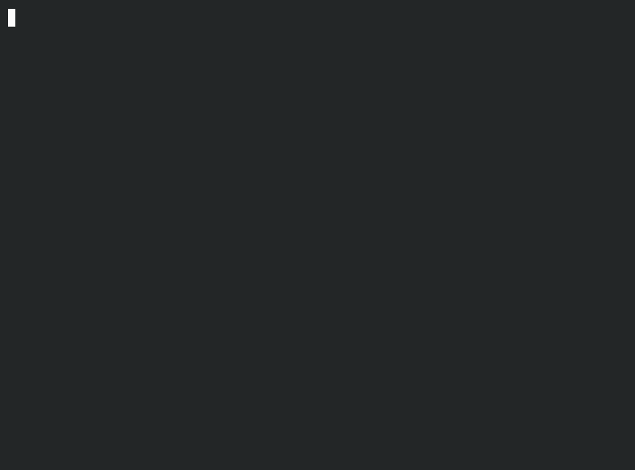

# Five Year Anniversary Card

A digital anniversay card I made for my partner to celebrate five years 
together. It was made using only official Python docs as reference as I felt 
using an LLM would make it less thoughtful. It doubly serves as a short piece 
of code to show some basic programming skills to a prospective employer so it 
is one of my pinned projects. 

